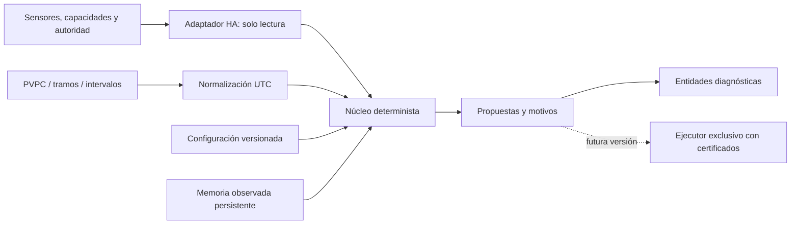

# Arquitectura y contrato

## Separación

- `domain/models.py`: configuración validada, lecturas inmutables, decisiones y
  memoria explícita. Sin entidades de ninguna vivienda incluidas en el código.
- `domain/tariffs.py`: proveedores → intervalos UTC completos y bloques ponderados.
- `domain/engine.py`: demanda local, mantenimiento, secado, presupuesto y arbitraje
  por instalación. Función reproducible con hora, instantánea y memoria dadas.
- `coordinator.py`: lee HA, convierte unidades, restaura memoria versionada y
  actualiza a60s o cambio relevante. No llama servicios de actuadores.
- `config_flow.py`: formularios nativos; opciones recargan la entrada. Ediciones
  inválidas no contaminan el siguiente intento. Se impide realimentar propuestas.
- `sensor.py`, `binary_sensor.py`, `entity.py`: salidas diagnósticas traducidas,
  identificadores estables y metadatos nativos. Sin notificaciones push.

## Orden de decisión

1. Autoridad Manual; después salidas de seguridad de sesión propia, incluso
   pausada. La alfa nunca se atribuye una sesión externa.
2. Habilitación, datos ambientales, horario y presencia.
3. Protección por exceso y demanda térmica con histéresis.
4. Solo sin demanda térmica propia, humedad estable/deuda/urgencia.
5. Suelo, exterior, presupuesto, ventana completa.
6. Instalación compartida: Manual y estado conocido, compatibilidad de sentido,
   mínimos de operación, inversión, potencia y cadencia.

La temperatura tiene prioridad de demanda; esto no significa ocultar humedad
excesiva: `service_blocked` muestra urgencia no atendible. Un bloqueo es un resultado
observable con motivo, no el estado engañoso de «todo bien».

## Persistencia y reinicio

`Store` esquema1 guarda deuda/timers/presupuesto por UUID y dirección observada de
instalación. No escribe un objetivo propuesto como si se hubiese ejecutado.
Datos incompatibles se descartan por objeto; recarga elimina listeners y guarda
memoria. La alfa no reserva sesiones ni actualiza `last_sent`: esas operaciones
pertenecerán al futuro ejecutor, tras aceptación real.

La persistencia de presupuesto aquí es una base, **no** una certificación de
exactly-once ni una protección autónoma ante caída de HA. Un futuro ejecutor
requerirá registro transaccional previo al envío, ACK, reconciliación y autoridad
por generación. No debe reutilizar sin más la memoria del observador.

## Capacidades, no marcas

El modelo distingue instalación y estancia. Un multisplit con sentido compartido
no puede prometer calor y secado/frío simultáneos. Plantas independientes pueden
tener sentidos distintos. Se leen modos, límites y paso del `climate` real; una
capacidad ausente bloquea la propuesta. Aún no hay adaptadores de actuadores
binarios, válvulas, bombas, ventilación ni deshumidificador dedicado.

## Observabilidad y privacidad

Se exponen objetivo ambiental, consigna física propuesta, humedad inicio/fin y
fase/motivo. El modo observado no se llama «compresor encendido». La potencia
agregada nunca se atribuye por estancia. El diagnóstico descargable excluye
bindings, nombres, horarios, ocupación y lecturas; los atributos locales de
entidades sí contienen lecturas de la vivienda y no deben publicarse.
