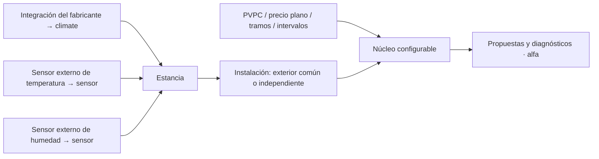

# Splits, sensores externos y tarifas: contrato de compatibilidad

## Qué se conecta

La integración del fabricante sigue siendo responsable de hablar con cada equipo.
No se incluyen librerías Midea, Daikin, Mitsubishi, Panasonic, Tuya u otras:
esta integración **consume el contrato HA**, no sustituye esos drivers.
Las marcas anteriores son ejemplos de posibles fuentes, no una lista certificada.

| Elemento | Contrato de entrada |
|---|---|
| Split | `climate`, modo conocido, `hvac_modes`, límites `min_temp`/`max_temp`, paso y consigna. Solo se proponen capacidades anunciadas por el equipo. |
| Referencia ambiental | `sensor` numérico con unidad°C o°F; el valor externo gobierna la demanda, no se sustituye por el sensor del split. |
| Humedad | `sensor` opcional numérico0–100%; sin él no se modela secado por humedad, pero sigue la demanda térmica. |
| Temperatura interna | `current_temperature` del equipo cuando exista y esté reciente; sirve para aliviar/corregir la propuesta, no como referencia ambiental universal. |
| Autoridad | `input_boolean` opcional: on autoriza propuestas; off/desconocido conserva Manual. |
| Potencia | `sensor` opcional W/kW agregado; no se inventa consumo por split ni se usan VA. |
| Tarifa | Independiente del equipo y de sus sensores; seleccionar uno de los proveedores documentados. |

Cada estancia puede usar una combinación distinta de marcas/protocolos. Una planta
agrupa los equipos que realmente comparten una unidad exterior/sentido: no agrupar
por ser de la misma marca. Equipos independientes pueden tener sentidos distintos.
El comportamiento físico de un multisplit debe confirmarse con su fabricante.

## Ejemplo de alta en otra vivienda

1. Integrar los splits y las sondas externas en HA y confirmar valores/unidades.
2. Añadir Home Climate Orchestrator; seleccionar zona horaria y tarifa.
3. Crear una instalación por exterior real y declarar si comparte sentido.
4. Añadir cada estancia: `climate`, temperatura externa, humedad externa opcional,
   permiso de secado y autorización. No copiar IDs de otra casa.
5. Ajustar confort, horarios, umbrales HR/precio, histéresis y tiempos en Opciones.
6. Examinar propuestas/motivos con datos válidos, incluidos pérdida de sensor,
   ausencia de precios futuros, noche y Manual.

## Límites de la alfa

- No envía órdenes, aunque los equipos y sensores sean compatibles.
- HA nativo en Celsius; sensores Fahrenheit externos se convierten. El control
  con HA configurado en Fahrenheit no está certificado.
- Un equipo solo frío no recibe propuesta de calor; sin `dry` no recibe propuesta
  de secado. No se supone que `fan_only` quite agua.
- Un remoto IR sin retorno de estado no acredita modo, mínimo de reposo ni ACK.
  No habilitar un futuro ejecutor físico sin resolver esas limitaciones.
- Falta de sensor, mala unidad o dato antiguo se muestra como bloqueo/degradación;
  no se inventan valores para que la propuesta salga verde.
- Calderas, válvulas, suelo radiante y deshumidificadores dedicados requieren
  adaptadores propios; esta alfa está centrada en splits de aire acondicionado.

## Tarifas disponibles

PVPC usa el sensor nativo HA y sus horas publicadas. Los tramos fijos permiten
días semanales, madrugada y excepciones por fecha; se validan cobertura y solapes.
Precio plano se configura numéricamente. Un proveedor genérico expone intervalos
con fechas/zona y EUR/kWh o EUR/MWh, también con granularidad subhoraria.
No se necesita PVPC para usar tramos fijos, ni se incluye una factura real.

Véanse [configuración completa](CONFIGURATION.md) y los perfiles ficticios de
`examples/`. La combinación exacta de equipos se valida por instalación: formato
genérico no significa compatibilidad física universal.
