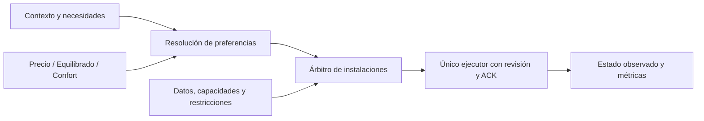

# Estrategias de clima: precio, confort y equilibrio

**Estado:** diseño aprobado para desarrollo; primera candidata MVP implementada
localmente en0.2.0a7. No instalada, publicada ni activada. Documento de producto
neutral; no contiene configuración, dispositivos, preferencias ni históricos de
una vivienda. No autoriza publicación o despliegue por su mera existencia.

## Seguimiento de implementación

Ampliación aprobada: admitir fuentes opcionales de presencia, movimiento u otras
señales por habitación, con significado configurable y sin reglas de una vivienda.
Contrato de lo implementado: [estrategias y actividad](../STRATEGIES_ACTIVITY.md).

| Fase | Avance verificable en la candidata | Gate pendiente |
|---|---|---|
|P0|ADR008 y contrato separan estrategia, preferencias, evidencia y autoridad.|Revisión de contrato por cada nueva topología.|
|P1|Origen/recepción/proveedor explícitos; reloj vinculado o atributo; Repairs agrupado; pérdida de precio no bloquea las estrategias nuevas; evidencia de habitación triestado y pulsos persistentes.|Validar garantías reales de cada proveedor; no certificar como medida el mero timestamp de un mensaje.|
|P2|Preferencias y concesiones por zona/día/sueño, moneda explícita y unidades coherentes; rechazo de mezcla y relabel de ledger, sin cambiar energía original.|Migración de moneda dentro de una entrada y formularios avanzados localizados en °F no implementados.|
|P3|Precio/Equilibrado/Confort comparten árbitro, plazos y bandas explícitas; preview separado; oportunidades térmicas y de humedad acotadas.|Sin precarga, modelo energético ni ahorro físico demostrado.|
|P4|Selector traducido, hot-apply e idempotencia; formularios de preferencias y varias fuentes de actividad; Manual y sesiones conservados.|Inspección visual de frontend y accesibilidad.|
|P5|Entradas anteriores conservan legacy y autoridad; nuevos campos de memoria separados; versiones futuras rechazadas; recarga/retirada probadas con HA temporal.|Reversión operativa y migración de un escritor externo requieren inventario real; no equivalen a copiar código antiguo.|
|P6|Pruebas deterministas y suites nativas con servicios ficticios; documentación y CI amplían la matriz.|Certificación física por equipo/topología.|
|P7|No iniciado en producción; ninguna instalación ni actuación se deduce de estas pruebas.|Preview con fuentes reales y consumidores; después piloto con escritor único y reversión verificada.|

Esto es una primera entrega de software revisable, **no el cierre de las ocho
fases ni una certificación universal**. Boost/vacaciones avanzado, precarga
compuesta de humedad, solar, carbono y aprendizaje siguen diferidos.

La auditoría de la sección2 conserva sus cifras/versiones de la evaluación
previa; no describe el estado del nuevo código. Véase la evidencia actual en
[VALIDATION.md](../VALIDATION.md).

## 1. Decisión recomendada

Añadir tres estrategias seleccionables: **Precio**, **Confort** y **Equilibrado**.
No crear tres controladores ni tres copias de las tablas. Todas deben producir
planes para el mismo árbitro de instalaciones y el mismo ejecutor protegido.

Separar cinco conceptos que hoy pueden confundirse:

| Eje | Ejemplos | Qué decide |
|---|---|---|
|Estrategia|Precio, Confort, Equilibrado|Qué concesiones de confort/coste se aceptan.|
|Contexto|En casa, Ausente, Dormir, Vacaciones|Qué necesidades y horarios se aplican.|
|Servicio|Calefacción, refrigeración, extracción de humedad|Qué demanda real hay que atender.|
|Autoridad|Automático, Manual, pausa, observación|Quién puede ordenar, nunca una preferencia económica.|
|Restricción|Ventana abierta, silencio, límite eléctrico, mínimos técnicos|Qué acciones están permitidas.|

Cambiar de estrategia no cambia autoridad, presencia, sentido físico ni modo
HVAC por sí mismo. Un perfil de precio no equivale al preset `eco` del fabricante.
Equilibrado sería la sugerencia para **instalaciones nuevas**, cuya ejecución
seguiría deshabilitada inicialmente. Instalaciones existentes conservarían su
política mediante `legacy`, sin conversión automática a Equilibrado.

## 2. Auditoría de la base de producto

Base inspeccionada: rama pública local0.1.0a1 y candidata0.2.0a6, commit
`c6aeb6d`. La rama pública remota consultada sigue declarando0.1.0a1. La
candidata pasa195 pruebas del núcleo en esta evaluación. No se han implementado
ni probado las estrategias nuevas. No se han repetido las suites HA/UI porque
este trabajo es de análisis/documentación, no una entrega ejecutable.

| Hallazgo | Evidencia en la candidata | Consecuencia |
|---|---|---|
|No existe selector de estrategias|`const.py`: plataformas sensor/binary_sensor/switch/number; `Policy` y `evaluate()` aplican un solo recorrido.|No basta con añadir tres etiquetas. Hay que separar restricciones y preferencias.|
|Precio ligado a objetivos|`models.py:default_bands`, `engine.py:evaluate` selecciona metas por banda antes de evaluar la demanda.|No representa un perfil Confort independiente de la tarifa.|
|Configuración agrupada|`Policy` mezcla frescura, límites de equipo, regulación, humedad y precio extremo.|Evitar que seleccionar Precio cambie mínimos técnicos o protecciones.|
|Frescura de recepción|`coordinator.py:reading` usa `state.last_reported`; `Reading` solo contiene valor y fecha.|Una republicación puede parecer nueva sin demostrar origen nuevo. Generalizar el contrato de calidad de la fuente.|
|Moneda limitada|`tariffs.py:generic_intervals` acepta unidades EUR; `sensor.py` publica EUR y EUR/h.|No presentar todavía optimización de coste como universal.|
|Cambio de opciones puede recargar|Solo las tablas tienen hot-apply especial; el resto usa `async_reload`.|Cambiar estrategia no debe retirar fuentes, perder entidades ni provocar ráfagas de trabajo.|
|Documentación desfasada|Arquitectura aún enumera deshumidificador dedicado como no soportado; código/validación sí incluyen `humidifier_entity` y planta independiente.|Matriz de capacidad y documentación deben reflejar código probado, no promesas.|
|Base útil ya existente|Motor puro, instalaciones/zonas, permisos, journal/ACK, reservas, persistencia, Manual y contadores por ámbito.|Extender esta separación, sin introducir otro emisor.|

Las195 pruebas no certifican compatibilidad física con todos los aparatos,
ahorro, extracción de agua ni migración de un controlador externo completo.

## 3. Contrato funcional de las tres estrategias

| Aspecto | Precio | Equilibrado | Confort |
|---|---|---|---|
|Meta preferida|Permite más flexibilidad explícita.|Mantiene una flexibilidad moderada.|Permanece cerca de la preferida.|
|Franja cara|Puede desplazar servicio dentro de banda y plazo autorizados.|Puede esperar poco, sin acumular incomodidad.|No aplaza demanda de confort solo por precio.|
|Franja barata|Puede adelantar energía si existe una oportunidad útil y acotada.|Solo anticipación limitada y justificada.|Aprovecha oportunidades sin sobreacondicionar innecesariamente.|
|Humedad|Busca oportunidad, con plazo máximo de servicio y límites comunes.|Atiende demanda sostenida, combinando oportunidad y temperatura.|Prima atender humedad/confort viable frente a esperar la tarifa.|
|Equipo ya funcionando|Regula y valora aplazamientos sin conmutación rutinaria.|Favorece estabilidad y coste razonable.|Favorece continuidad dentro del confort, sin demanda térmica artificial.|
|Sin previsión|Desactiva desplazamientos que no puede justificar.|Continúa regulación local.|Continúa regulación local.|
|Sin precio actual|Declara optimización económica degradada; aplica el respaldo autorizado.|Igual: no inventa precio ni ahorro.|Puede regular por confort sin afirmar coste conocido.|
|Tarifa plana|No inventa horas baratas; solo flexibilidad/eficiencia autorizadas.|Igual, sin esperas económicas artificiales.|Igual, siguiendo demanda.|

**Común a todas:** permisos, Manual, pausa, límites eléctricos, datos necesarios,
compatibilidad de sentidos, mínimos del fabricante y plazos de sesiones propias.
Precio no significa «apagar todo cuando sube»; Confort no significa «consumir sin
límite»; Equilibrado no significa un peso50/50 arbitrario entre euros y grados.

### Bandas y concesiones explícitas

Definir por zona y contexto:

- Objetivos preferidos de calor/frío, con separación válida entre ambos.
- Banda de flexibilidad admitida, distinta de los límites absolutos autorizados.
- Máximo de espera y máximo de desviación acumulada tolerable.
- Margen de anticipación, si se habilita, y tope de sobreacondicionamiento.
- Objetivos de humedad, persistencia, máximo de episodio y plazo de servicio.

Ejemplo **orientativo**, no preset universal: para una preferencia de21°C y una
banda autorizada19–22°C, Confort intentaría permanecer próximo a21; Equilibrado
podría permitir una concesión pequeña y breve; Precio podría esperar más y
usar más banda, nunca atravesar19°C por una optimización económica ordinaria.
Los márgenes efectivos deben elegirse y validarse; no se copian temperaturas,
horarios o umbrales monetarios de una instalación a todas las demás.

Ejemplo de decisión, aún no ejecutado: preferencia21°C, lectura20,3°C y una
ventana más barata dentro de45min. Confort puede recuperar la preferencia ya;
Equilibrado podría admitir una demora breve, por ejemplo15min; Precio podría
esperar la ventana si la banda autorizada y su plazo lo permiten. La espera se
revalida con cada lectura: no presupone que la casa conservará esa temperatura.
Estos tiempos ilustran concesiones configurables, no límites implantados.

Si se configura un presupuesto obligatorio que hace imposible el servicio,
mostrar el conflicto y su causa. No prometer simultáneamente coste máximo y
confort que el equipo/datos no permiten. Las protecciones específicas del
equipo y la autoridad siguen siendo restricciones, no pesos negociables.

## 4. Cómo decidir sin un optimizador ficticio

Primera entrega: motor determinista y explicable, sin LLM en la ruta crítica.

1. Validar fuentes y construir capacidades/restricciones por acción.
2. Aplicar autoridad, protecciones, reservas, mínimos y compatibilidad.
3. Resolver necesidades del contexto y objetivos preferidos/bandas autorizadas.
4. Estrategia genera alternativas factibles y motivos, no llamadas físicas.
5. Árbitro de instalación resuelve prioridades, sentido y suministro compartido.
6. Ejecutor revalida revisión, datos, permisos y propiedad antes de emitir.

Confort minimiza primero desviación de la banda preferida; entre alternativas
factibles favorece menor coste/desgaste. Precio favorece el coste **estimable**
sujeto a banda/plazo; sin modelo energético solo puede usar oportunidad de
tarifa, no afirmar una optimización en euros. Equilibrado limita explícitamente
cuánto confort y cuánto tiempo cede antes de aprovechar una oportunidad.

No afirmar que precio barato implica menor consumo: precalentar puede elevar
pérdidas y la eficiencia depende del equipo/condiciones. Sin modelo validado,
no activar precarga térmica oportunista por defecto ni prometer ahorro.
Comparar coste integral del episodio, recuperación y rebote cuando existan
mediciones y cobertura suficientes. No reconstruir COP a partir del modo HVAC.

## 5. Capacidad real y alcance de compatibilidad

| Equipo/topología | Primera cobertura propuesta | Límite |
|---|---|---|
|Split/inverter mediante `climate`|Calor/frío, consigna y modulación compatible.|No atribuir potencia del compresor al estado heat ni forzar presets del fabricante.|
|Varios splits independientes|Una instalación por equipo o grupos realmente compatibles.|Suministro general puede seguir siendo compartido.|
|Multisplit de sentido común|Árbitro conjunto, prioridad por zona y un sentido compatible.|Nunca prometer calor y dry/frío simultáneos si el equipo no los admite.|
|Deshumidificador dedicado|Actuador `humidifier` de clase deshumidificador, planta independiente.|Rechazar equipos que añaden agua; verificar depósito/disponibilidad/capacidades.|
|Termostato solo calor o frío|Certificar la delegación de consigna al driver existente.|No exigir una capacidad de frío a una calefacción solo calor.|
|Relé/resistencia simple|Solo a través de un adaptador/termostato HA ya protegido y certificado.|No añadir llamadas directas a `switch` dentro del motor de estrategias.|
|Suelo radiante, caldera, bomba hidráulica, VRF avanzado|Fases posteriores o delegación al controlador certificado.|No gestionar caudales, válvulas, desescarche o direcciones múltiples sin contrato específico.|

«Para todo el mundo» significa núcleo sin vivienda, marca, país, tarifa o número
de zonas fijos y compatibilidad declarada por capacidades. No significa afirmar
que cualquier aparato queda controlado correctamente desde el primer día.

Horarios, fines de semana, zona IANA, presencia y ausencia son configurables.
No asumir hemisferio, meses de invierno ni calendario laboral europeo. Las
duraciones mínimas y límites exteriores pertenecen a la capacidad/instalación,
no a una receta única para todos los compresores. Un termostato válido puede
ser la referencia ambiental elegida: no se exige comprar una sonda externa.
Normalizar temperaturas a SI internamente y admitir °C/°F en los límites de HA;
convertir objetivos absolutos y diferencias con reglas distintas (un delta °F
usa factor5/9, sin restar32). Respetar resolución y rango real del actuador.
La presencia es opcional; no se impone «nadie en casa = todo apagado». Un contexto
ausente puede conservar mantenimiento mínimo y humedad si se ha autorizado.
Cualquier protección física requerida debe existir también en el equipo cuando
HA, red o alimentación fallen: el software no promete autonomía fuera de su alcance.

## 6. Fuentes, fallos parciales y datos que no deben ser obligatorios

Introducir calidad de fuente y un grafo de dependencias por acción:

| Pérdida | Comportamiento propuesto |
|---|---|
|Temperatura ambiental requerida de una zona|No inventar confort con otra zona; bloquear/salir según su contrato, sin paralizar las sanas.|
|Precio o previsión|Suspender optimización/anticipación no justificable; mantener regulación local autorizada. Precio desconocido no es cero ni «barato».|
|Exterior solo para optimización|Desactivar esa optimización, no todo el servicio térmico.|
|Exterior exigida por límite de operación del equipo o política explícita|Bloquear únicamente las acciones que la necesitan, con causa visible.|
|HR opcional|Retirar servicio de humedad; no invalidar calefacción local sana.|
|Potencia configurada como protección obligatoria|No ignorar la pérdida; restringir nuevas cargas según el contrato.|
|Medidor solo informativo|Marcar coste/energía sin cobertura; no convertirlo en fallo global del clima.|
|Depósito desconocido/lleno|Vetar o parar deshumidificador propio; no mezclarlo con la planta térmica independiente.|

`Reading` debería distinguir valor, tiempo de medida/mensaje de origen si existe,
tiempo de recepción, procedencia, validez y semántica de actualización. No imponer
Zigbee ni exigir `last_seen` a todo sensor. Un sensor estable no está caducado por
no cambiar de valor; una caché republicada tampoco demuestra una medida nueva.
Documentar adapters por contrato: timestamp explícito, garantía del proveedor o
recepción con limitación declarada. Fuente incierta no debe presentarse como
frescura de origen probada.

Usar diagnósticos de fuente/edad/alcance y Repairs para incidencias accionables,
agrupadas y recuperables, no push a destinatarios domésticos incrustados. El
producto no reinicia coordinadores ni reempareja dispositivos para «arreglar»
un veto; ofrece diagnóstico y mantiene el control manual disponible.

## 7. Tarifas, monedas y medida

- `PricingSignal`: importe por kWh, moneda explícita y cobertura por intervalo.
  Aceptar EUR/USD/GBP/etc. sin asumir que0,20 significa lo mismo en todas.
- Normalizar kWh/MWh, céntimos/subunidades cuando estén declarados, UTC,
  intervalos15/30/60min y DST. Rechazar solapamientos, unidades ambiguas y
  mezcla de monedas; no hacer conversión FX implícita.
- Preferir bandas configurables o señales relativas comparables dentro de
  la misma moneda. Ponderar duraciones, no contar intervalos como si fueran iguales.
- Tarifa plana, por horarios, dinámica publicada y adaptador genérico validado.
  Forecast incompleto no se rellena con el precio actual ni con ayer.
- Precios cero/negativos no conceden demanda infinita, precarga ilimitada ni
  saltarse mínimos. Una factura incluye componentes que el precio variable
  puede no contener: explicitar el alcance y evitar sumar recargos dos veces.
- Cambiar moneda no relabela históricos existentes. Segmentar costes/estadísticas
  por moneda y migrar explícitamente; conservar energía e históricos medidos.
- Medición opcional por casa/planta/zona con ámbitos no solapados. Un contador
  agregado no se divide entre habitaciones ni se suma otra vez por jerarquía.

## 8. Otros modos evaluados

| Idea | Valor | Decisión |
|---|---|---|
|Dormir/silencioso|Confort nocturno y menos molestias.|Contexto/limitación, no cuarta estrategia. Solo ajustar ventilador si se ha permitido y el aparato lo admite; no garantizar dB.|
|Ausente/vacaciones|Prioridades y conservación distintas.|Contexto con objetivos propios, no un apagado obligatorio.|
|Refuerzo temporal|Recuperación puntual fácil de usar.|Override con alcance y vencimiento absoluto, sin autorizar lo técnicamente imposible. No renovar por reinicio o cambio de perfil.|
|Antihumedad|Servicio útil incluso con temperatura satisfecha.|Intento/servicio independiente; escoger recurso viable. Humedad persistente no espera indefinidamente por precio.|
|Autoconsumo solar|Puede aprovechar excedentes reales.|Segunda etapa opt-in con importación/exportación y ámbito medidos. Valorar energía exportable/almacenada: solar no significa coste cero.|
|Baja huella de carbono|Preferencia distinta de euros.|Segunda etapa con intensidad y cobertura explícitas; no estimar emisiones evitadas sin referencia comparable.|
|Adaptativo/aprendizaje|Puede mejorar anticipación y modelo de la vivienda.|Posterior, opt-in, calibración acotada y explicable; nunca cambiar límites/autoridad de forma autónoma.|
|Presupuesto estricto|Útil en casos particulares.|Restricción explícita y conflicto visible, no promesa de confort ilimitado.|

En el MVP: tres estrategias, contextos básicos, límites y diagnósticos. No añadir
un menú con diez modos mutuamente incompatibles. No confundir una preferencia de
servicio con el modo `dry` de todos los equipos.

### Servicio de humedad compuesto

Una sesión dry con propietario/plazo no equivale a tener un planificador genérico
de precarga→espera→secado→regulación normal. Tratar este último como una ampliación
explícita, no como una función certificada por las pruebas de sesiones actuales.
La primera entrega puede conservar secado viable sin precarga; cualquier precarga
debe ser opt-in y posterior a demostrar su necesidad y coste térmico.

Si se implementa: reservar un único plan por instalación con presupuesto,
endpoint, suelo y plazos absolutos; comprobar ventana completa y viabilidad
térmica; devolver la meta normal antes de esperar compatibilidad; entrar en dry
solo con margen y mínimos cumplidos; terminar o declarar servicio no atendible
al agotar el plazo. La calefacción posterior depende de demanda normal y de los
tiempos de inversión: nunca una tercera orden obligatoria que cree un bucle.

Priorizar recursos independientes cuando sean viables evita interrumpir una
planta térmica compartida, pero no demuestra que sean siempre más baratos.
Ninguna estrategia puede sacrificar una zona Manual o fuera de confort para
secar otra. Cambiar de perfil no borra la deuda ni reinicia un plan fallido.
La ampliación requiere sus propias pruebas/observación; estimar2–4 jornadas
adicionales de implementación aislada, sin incluir validación física.

## 9. Cambio de estrategia sin ciclos ni pérdida de propiedad

Exponer un `select` nativo con claves estables traducidas: `price`, `balanced`,
`comfort`; para migraciones, `legacy` debe seguir siendo una opción válida y
reversible. No reutilizar el `hvac_mode` ni llamar a un preset del fabricante.

Proceso de cambio:

1. Validar y persistir selección/configuración completa de forma atómica.
2. Incrementar revisión de estrategia/plan; revocar intenciones ordinarias viejas.
3. Solicitar un único recálculo coalescido con los estados actuales.
4. Mantener Manual, pausa, tiempos observados, dirección y presupuestos.
5. Revalidar antes/después del registro de intención y reconciliar lo ya emitido.

No reiniciar toda la entrada ni descargar celdas de configuración para este cambio.
Las tablas editadas mantienen identidad; no multiplicar cientos de números por
cada estrategia ni sobrescribir los valores del usuario con un preset nuevo.

Sesiones propias de secado conservan endpoint, suelo y máximo absoluto, salvo
que una restricción más estricta obligue a finalizar. Cambiar perfil no renueva
plazos, devuelve intentos o convierte una sesión ajena en propia. Una precarga
que deja de ser elegible retira su meta temporal por la ruta normal; no apaga
una habitación Manual para realizar el siguiente paso. Un cambio de sentido
sigue esperando sus mínimos aunque el nuevo perfil quiera actuar antes.

La elección humana del selector no es una orden HVAC Manual. El recálculo usa
el emisor identificado; una orden humana directa al aparato conserva precedencia,
incluso si coincide con una intención pendiente. Ensayar ambas procedencias.

## 10. UX y observación sin efectos indirectos ocultos

Panel cotidiano compacto:

- Estrategia elegida y efectiva: «Precio · sin optimización, falta tarifa».
- Objetivo ambiental/base, banda aceptada y consigna física como magnitudes distintas.
- Decisión/motivo, condición de desbloqueo y próximo vencimiento.
- Manual/pausa e incidencia accionable, sin exponer tablas avanzadas a diario.

La entrega de interfaz debe incluir controles Lovelace de la estrategia real
y acceso a preferencias/actividad opcional, sin habilitar ejecución al elegir
perfil. Mostrar potencia y energía con alcance/cobertura explícitos y enlace
al detalle, sin reparto ficticio por zona. Añadir una pestaña de auditoría
administrativa de solo lectura: estrategia elegida/efectiva, decisión y motivo,
guarda que veta, evidencia y frescura, objetivo ambiental frente a consigna,
concesión activa, condición de desbloqueo y vencimiento absoluto. Separar
propuesta, orden emitida, ACK y estado observado; no derivar un motivo de la
mera coincidencia del estado. Validar visualmente en móvil y escritorio.
Estos requisitos de frontend y su piloto siguen pendientes en esta candidata;
las entidades nativas y sus pruebas de servicios no equivalen a entregar el
dashboard de una instalación.

Global por vivienda en el MVP; prioridades por zona y árbitro conjunto. Overrides
por instalación independiente serían una ampliación posterior, subordinados al
suministro común. Evitar estrategias rivales por cabeza de un multisplit.

La configuración avanzada contiene flexibilidad, plazos, horarios y límites.
Metadatos nativos, IDs estables, nombres traducidos ES/EN y áreas reales; ninguna
habitación ficticia para elementos globales. No introducir un `climate` virtual
que sustituya equipos durante esta fase.

**Observación no garantiza ausencia de consumidores externos.** Aunque el
orquestador no llame a aparatos, una automatización ajena puede consumir sus
objetivos. Las comparaciones de estrategias deben publicarse en salidas de
preview diferenciadas, sin cambiar metas ya enlazadas a otros controladores.
Inventariar consumidores antes de activar nuevas metas. No se puede garantizar
la ausencia de automatizaciones dinámicas externas solo por revisar referencias
literales. Elegir perfil tampoco habilita ejecución en una entrada observadora.

## 11. Diseño técnico propuesto

Mantener el motor sin HA/I/O/reloj global. Recibir tiempo, fuentes, capacidades,
contexto, selección, memoria y límites como snapshot explícito e inmutable.

| Módulo | Cambio acotado |
|---|---|
|`domain/models.py`|Separar estrategia/preferencias de restricciones, añadir revisión y calidad de lectura; adaptador legacy.|
|`domain/strategies.py` nuevo|Compilar preferencias/bandas/plazos y alternativas factibles con motivos estables.|
|`domain/sources.py` nuevo|Semántica de origen/recepción y dependencias; no integrar protocolos domésticos en el núcleo.|
|`domain/engine.py`|Consumir estrategia resuelta, conservando arbitraje, propiedad y salidas. Sin tres motores duplicados.|
|`domain/tariffs.py`, contabilidad, sensores|Moneda/unidades/cobertura explícitas y migración de costes.|
|`coordinator.py`|Hot-apply de estrategia, revisión, listeners por dependencia y recálculo coalescido.|
|`execution.py`, procedencia/journal|Certificado de revisión; no adoptar llamadas antiguas tras cambio/reinicio.|
|`select.py`, `const.py`|Nueva plataforma y selector sin llamadas directas a actuadores.|
|`config_flow.py`, traducciones|Wizard simple, límites avanzados, capacidades no disponibles y estado efectivo.|
|Migración/persistencia|Esquema versionado, lectura legacy, conservación de IDs/tablas/plazos, rechazo de versiones futuras desconocidas.|

No hacer una reescritura completa de `Policy` en un solo commit. Crear la fachada
compatible, mover responsabilidades por fases y ejecutar regresiones en cada delta.

## 12. Plan de trabajo por entregas

Estimaciones orientativas de jornadas de trabajo efectivo, no compromiso de fecha.
Los periodos de prueba física son adicionales y dependen de episodios útiles.

| Fase | Entrega | Criterio de salida | Esfuerzo orientativo |
|---|---|---|---|
|P0 Contrato|ADR de ejes, prioridades, compatibilidad y esquema.|Casos concretos de las tres estrategias y conflictos resueltos; ninguna regla doméstica incrustada.|1–2 jornadas|
|P1 Fiabilidad portable|Calidad de origen, dependencias y motivos por acción.|Pérdida de fuente opcional no paraliza servicios sanos; datos cacheados no se certifican como nuevos; diagnóstico accionable.|3–5|
|P2 Preferencias y moneda|Bandas/plazos explícitos, moneda/unidades y migración legacy.|Mismos límites para las tres estrategias, tarifa plana/negativa/ausente y moneda distinta de EUR probadas; histórico preservado.|3–5|
|P3 Estrategias del núcleo|Precio/Confort/Equilibrado y preview contrafactual.|Decisiones diferentes y explicables solo donde hay concesión autorizada, sin llamadas ni presupuestos reales en preview.|3–5|
|P4 UX/transiciones|Selector, opciones, traducciones y hot-apply.|Cambiar repetidamente no recarga entidades, no crea Manual, no renueva sesiones ni cambia autoridad.|2–4|
|P5 Integración/migración|Esquemas, journaling, lifecycle y reversión.|Upgrade conserva política existente; ejecución no se habilita; rollback ensayado con estado vivo de sesiones.|3–5|
|P6 Certificación|Matriz de equipos, HA y fallos, más documentación reconciliada.|Cero violaciones de restricciones en los casos probados; compatibilidad por capacidad declarada, no universalidad asumida.|4–7|
|P7 Pilotos|Observación y después una instalación real por topología certificada.|Sin escritores concurrentes, prueba natural de control y métricas con cobertura; reversión disponible.|Variable|

El MVP requiere unas19–33 jornadas según estas estimaciones; P7 no cabe en una
promesa fija. Ejecutar P0/P1 antes de embellecer el selector. No hace falta esperar
semanas para desarrollar pruebas aisladas; sí hacen falta episodios comparables
para afirmar confort, secado o ahorro físicos.

## 13. Pruebas y aceptación

### Núcleo determinista

- Para el mismo snapshot, comparar tres estrategias y la política legacy.
- Comprobar que una estrategia nunca genera acciones fuera de capacidades,
  autoridad, banda obligatoria, límites eléctricos o mínimos del fabricante.
- Casos con tarifa plana/por tramos/dinámica, intervalos mixtos y DST, cero,
  negativos, huecos, moneda/unidad incoherentes y predicción incompleta.
- Fuente local perdida, exterior requerida/opcional, HR o medidor opcional
  ausente, caché republicada, origen futuro y temperatura estable durante horas.
- Prioridades, multisplit incompatible, plantas independientes y suministro común.
- Humedad sostenida/picos, frío sin margen, equipo dedicado ausente/depósito lleno;
  servicio no atendible explícito, nunca bucles calor-dry-calor sin presupuesto.

### HA real aislado

- Usar imagen HA mínima soportada y objetivo actual, sin red/dispositivos/mounts
  productivos ni credenciales heredadas; todos los servicios físicos doblados.
- Setup, cambio por `select.select_option`, edición rápida, reload, upgrade y
  eliminación; mismo UUID, traducciones y metadatos. Errores no guardan medios perfiles.
- Perfil→recálculo→emisor real→doble: no basta con probar un goal suministrado
  a mano o una función que nunca alcanza el servicio.
- Cambiar de estrategia durante marcha mínima, Manual, pausa, dry, ACK pendiente,
  corte crítico y retirada de carga. Variar órdenes de eventos y reinicios.
- Distinguir selección humana de estrategia y orden HVAC humana coincidente.
- Revisión vieja no ejecutable, perfil igual idempotente, sin ráfaga de
  entidades ni pérdida de sesiones/listeners al hot-apply.
- Preview no muta contabilidad real, intentos, propietarios, journal o metas
  enlazadas. No hay llamadas físicas en observación ni doble reclamación de actuador.

### Física y métricas

Cada topología pasa primero shadow/replay de decisiones; después actuación
controlada de un solo escritor y observación natural. Un replay no predice por
sí solo la temperatura que habría causado otro perfil. No comparar euros de
días distintos como ahorro causal.

Medir cobertura de fuentes, tiempo fuera de banda, grado-minutos de desviación,
espera de servicio, arranques/inversiones, órdenes, kWh/importe variable medidos,
HR/rocío y rebote de episodios propios. Normalizar comparaciones por contexto,
meteorología y versión; no repartir energía de una planta entre sus cabezas.

Criterio bloqueante: ninguna violación de autoridad/restricciones en pruebas;
ninguna regresión demostrada de lifecycle, persistencia o devolución de control.
El perfil Precio no recibe una etiqueta de ahorro probado hasta disponer de
medición comparable. Rendimiento: trabajo coalescido y sin aumentar listeners
por cada cambio de perfil; medir latencia/CPU en el entorno objetivo.

## 14. Migración y despliegue

1. Separar migración equivalente de un controlador existente de la activación de
   políticas nuevas: no cambiar ambos problemas a la vez.
2. Backup versionado de config/estado propios y manifiesto; instalación nueva
   observadora; actualización mantiene autoridad y selección legacy.
3. Introducir esquemas y compatibilidad antes del selector público. Desconocido
   o corrupto bloquea el ámbito afectado con diagnóstico, no factory reset.
4. Ensayar preview paralelo sobre snapshots sin adoptar sesiones reales.
5. Activar estrategia solo mediante el propietario de ejecución certificado o
   adaptador externo explícito; inventariar consumidores de metas publicadas.
6. Rollback: vetar nuevas intenciones, reconciliar ya transmitidas/sesiones/deuda,
   restaurar solo configuración compatible. No basta con copiar un fichero viejo.
7. Antes de publicar: tests núcleo, smoke, lifecycle, config flow, entidades,
   ejecución y humedad/contabilidad; CI, documentación, privacidad y changelog.
   Una revisión del plan no incrementa manifest ni instala una versión.

## 15. Fuentes y referencias

- Código auditado: `domain/models.py`, `domain/engine.py`, `domain/tariffs.py`,
  `coordinator.py`, `execution.py`, `config_flow.py`, `validation.py`, `sensor.py`.
- [Arquitectura actual](../ARCHITECTURE.md), [migración](../MIGRATION.md),
  [ejecución/energía](../EXECUTION_ENERGY.md). Las discrepancias detectadas se
  deben reconciliar en P0/P6, no esconder mediante una nueva etiqueta de versión.
- [SelectEntity oficial](https://contributors.home-assistant.io/core/entities/select/):
  opciones estables/traducibles y acción nativa de selección.
- [ClimateEntity oficial](https://contributors.home-assistant.io/core/entities/climate/):
  HVAC, preset, capacidades y unidades son contratos distintos.
- [Repairs oficial](https://contributors.home-assistant.io/core/integrations/repairs/):
  mecanismo nativo para problemas que requieren atención y resolución.

Todas las alternativas, parámetros y plazos anteriores son propuestas. La
compatibilidad que no esté ensayada debe seguir figurando como pendiente.
